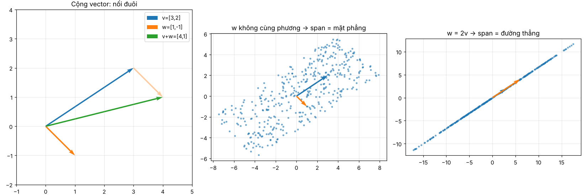

# Ngày 001 — Vector, tổ hợp tuyến tính, span và cơ sở

> **Nguồn:** 3Blue1Brown *Essence of Linear Algebra* — [Tập 1](https://www.youtube.com/watch?v=fNk_zzaMoSs), [Tập 2](https://www.youtube.com/watch?v=k7RM-ot2NWY)
> **Thời gian:** 45' xem + ghi chép · 75' code NumPy

---

## 1. Vector là gì?

Cùng một khái niệm, ba góc nhìn:

| Góc nhìn | Vector là... | Ví dụ |
| --- | --- | --- |
| Vật lý | Mũi tên có độ dài và hướng | Vận tốc, lực |
| Lập trình | Danh sách số có thứ tự | `[3, 2]`, một hàng dữ liệu |
| Toán | Thứ cộng được với nhau và nhân được với số | — |

Trong linear algebra, ta hình dung vector là **mũi tên đặt gốc tại (0, 0)**. Vector `[3, 2]` = đi 3 bước theo trục x, rồi 2 bước theo trục y.

### Hai phép toán nền tảng

- **Cộng vector:** đặt đuôi của `w` vào đầu của `v`. Điểm cuối chính là `v + w`. Về số: cộng từng thành phần, `[3, 2] + [1, -1] = [4, 1]`.
- **Nhân với số (scalar):** kéo dài (`2v`), co lại (`0.5v`) hoặc lật ngược (`-v`). Về số: nhân từng thành phần.

Toàn bộ linear algebra được xây trên đúng hai phép toán này.

## 2. Tổ hợp tuyến tính và vector cơ sở

Hai **vector cơ sở** chuẩn của mặt phẳng: `î = [1, 0]` và `ĵ = [0, 1]`.

Thật ra `[3, 2]` là cách viết tắt của **3î + 2ĵ**. Mỗi tọa độ là một con số "kéo giãn" vector cơ sở tương ứng.

**Tổ hợp tuyến tính** của `v` và `w`: `a·v + b·w`, với `a`, `b` là số bất kỳ.

## 3. Span

**Span** của một tập vector = tập hợp **tất cả** các điểm đạt được bằng tổ hợp tuyến tính của chúng.



- **Hình trái:** cộng vector bằng quy tắc nối đuôi.
- **Hình giữa:** `v` và `w` không cùng phương. Mỗi chấm là một tổ hợp `a·v + b·w` với `a, b` ngẫu nhiên trong `[-2, 2]`. Các chấm phủ một hình bình hành; nếu cho `a, b` chạy khắp mọi số thực thì chúng phủ **toàn bộ mặt phẳng**.
- **Hình phải:** `w = 2v` cùng phương với `v`. Dù chọn `a, b` thế nào, mọi điểm vẫn nằm trên **một đường thẳng**.

Trong không gian 3 chiều: span của 2 vector độc lập là một mặt phẳng; cần vector thứ ba nằm ngoài mặt phẳng đó thì span mới là cả không gian.

## 4. Độc lập tuyến tính và cơ sở

- **Phụ thuộc tuyến tính:** một vector là "thừa" nếu nó đã nằm trong span của các vector còn lại (bỏ nó đi span không đổi). Ví dụ `2v` thừa khi đã có `v`.
- **Độc lập tuyến tính:** không vector nào thừa.
- **Cơ sở (basis)** của một không gian = tập vector **độc lập tuyến tính** có **span là toàn bộ không gian đó**.

Kiểm tra nhanh bằng NumPy: ghép các vector thành cột của ma trận và tính **hạng (rank)**. Rank = số vector độc lập = số chiều của span.

## 5. Code

```python
import numpy as np

v = np.array([3, 2])
w = np.array([1, -1])

v + w                 # [4, 1]
2 * v                 # [6, 4]
2 * v + 3 * w         # tổ hợp tuyến tính: [9, 1]

i_hat, j_hat = np.array([1, 0]), np.array([0, 1])
3 * i_hat + 2 * j_hat # [3, 2] — chính là v

np.linalg.matrix_rank(np.column_stack([v, w]))      # 2 → độc lập, span = mặt phẳng
np.linalg.matrix_rank(np.column_stack([v, 2 * v]))  # 1 → phụ thuộc, span = đường thẳng
```

## 6. Liên hệ với AI

- **Embedding là vector.** Một từ, một câu, một ảnh được biểu diễn thành vector hàng trăm chiều. Các thứ có nghĩa gần nhau thì vector nằm gần nhau. Đây là nền tảng của tìm kiếm ngữ nghĩa và RAG (tháng 8).
- **Ảnh là tập hợp vector.** Ảnh màu là các vector `[R, G, B]` tại mỗi pixel.
- **Rank thấp = dữ liệu thừa.** Nếu dữ liệu chỉ nằm trên một "mặt phẳng con" thì có thể nén lại mà không mất nhiều thông tin. Đây là ý tưởng phía sau PCA và nén ảnh bằng SVD (tuần 3–4 tháng này).

## 7. Tự kiểm tra

- [ ] Giải thích được vì sao `[3, 2]` = `3î + 2ĵ`
- [ ] Vẽ được `v + w` bằng quy tắc nối đuôi
- [ ] Nói được span của hai vector cùng phương là gì
- [ ] Biết dùng `matrix_rank` để kiểm tra độc lập tuyến tính
- [ ] Trả lời: trong không gian 3 chiều, 3 vector cùng nằm trên một mặt phẳng thì span là gì?

## 8. Câu hỏi còn mở

- Một tập 3 vector trong mặt phẳng 2 chiều có thể độc lập tuyến tính không? Vì sao?
- Có thể chọn cơ sở khác `î, ĵ` cho mặt phẳng không? Khi đó tọa độ của `[3, 2]` thay đổi thế nào? *(Gợi ý: tập 13 — đổi cơ sở)*
